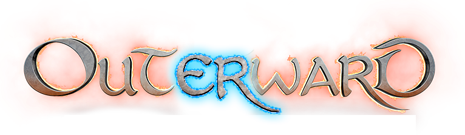
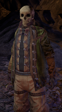

### !!EXPERIMENTAL!!
This mod has not been extensively tested just yet, thus may cause issues during online play & when removed. Read extra notes for more info.

## Outerward

**Outerward** is a custom race mod for Outward which adds more races to the game. 
(Currently) Adds 1 new race to the game.

## New Race(s)

- **Mertonfolk**, the Skeleton race. 
 (This makes as much sense as Myriade being in the game LOL...) 

Third-party race documentation to be done and support to be tested, all assets used in this mod is using Outward's resources. (Merton's set.)

## Change Log

0.0.3
- Fixed feet and boots not appearing when they should.
- Fixed race model rendering. (Better support for armor which uses skin material.)
- Modded data is now only applied to humanoid NPCs to minimize the mod's reach, support custom race NPCs and solve the issue in 0.0.2.
- Added support for special models.

0.0.2
- Fixed a bug that disabled all non-humanoid character models.

0.0.1
- Initial release. Contains one default race.

## Planned Features

(Keep in mind, this is just a college student's hobby project so there is no guarantee that they will all be completed.) 
In no particular order:
- Complete third-party mods support/SideLoader compatibility for easy third-party implementations.
- More base races on the Outerward.
- Replacing the vanilla races features.
- Full character creator remake.
- Ability to implement extra racial features. (Such as passives/active skills, configurable custom behavior for other mods)
- Customizable character-centric mechanics such as differing sounds; combat reactions, footsteps, etc. (Thanks, Sororitas!)

## Extra Notes
### Experimental Risks
All content made in this mod has only been partially tested, and is not reverse-compatible with modded saves after being uninstalled.
Multiplayer does not have full support, though networking support has been implemented albeit effects have not been tested.
### Experience
For it being my magnum opus, (*not Claude Opus*, **no Generative AI was used** in the process of developing this mod.) it has been in the works and first saw real progress since August 2026, so it has not been extensively tested just yet.

## Credits
- modifamorphic, taught me on applying visuals & localization methodology was referenced.
- sinai, Pioneer of the Outward modding scene & UnityExplorer.

## Contact

You may contact me through the [Outward Modding Community](https://discord.gg/byKHkxtKka) Discord server.